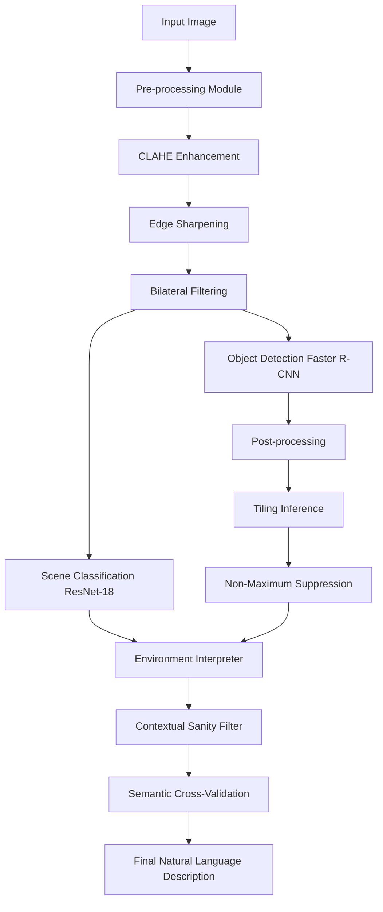

# Algorithm Descriptions & System Workflow

This document provides a detailed explanation of the algorithms used in the **Intelligent Environment Image Interpreter** project, covering pre-processing, core machine learning models, and post-processing/interpretation logic.

---

## 1. System Pipeline Overview

The system follows a sequential pipeline where an input image is enhanced, analyzed by two specialized models, and finally interpreted using a rule-based engine.



---

## 2. Pre-processing Algorithms

The pre-processing module ensures the image is optimized for neural network feature extraction.

### A. Contrast Limited Adaptive Histogram Equalization (CLAHE)
CLAHE is used to improve image contrast, especially in low-light or overexposed scenes, without amplifying noise in homogenous areas. Unlike global histogram equalization, CLAHE operates on small tiles (grid size 8x8) and clips the histogram to prevent extreme contrast.

### B. Bilateral Filtering (Noise Reduction)
To reduce noise while preserving sharp edges (critical for object boundaries), we use a Bilateral Filter.
*   **Algorithm**: It replaces the intensity of each pixel with a weighted average of intensity values from nearby pixels. Weights depend on both Euclidean distance and photometric difference (color similarity).

### C. Pre-processing Pseudocode
```python
ALGORITHM ImagePreprocessing(InputImage):
    # 1. Contrast Enhancement
    LabImage = ConvertToLAB(InputImage)
    L_channel = ApplyCLAHE(LabImage.L, clipLimit=3.0, grid=(8,8))
    EnhancedImage = ConvertToRGB(Merge(L_channel, LabImage.A, LabImage.B))
    
    # 2. Edge Sharpening
    Kernel = [[-1,-1,-1], [-1,9,-1], [-1,-1,-1]]
    SharpenedImage = Convolve(EnhancedImage, Kernel)
    
    # 3. Noise Reduction
    FinalImage = BilateralFilter(SharpenedImage, d=9, sigmaColor=75, sigmaSpace=75)
    
    RETURN FinalImage
```

---

## 3. Core Machine Learning Algorithms

### A. Object Detection: Faster R-CNN
The project uses a custom-trained **Faster R-CNN** (Region-based Convolutional Neural Network) for detecting specific objects (persons, vehicles, animals).

*   **How it works**:
    1.  **Backbone**: A ResNet-50/101 extracts feature maps from the image.
    2.  **Region Proposal Network (RPN)**: Proposes potential object locations (bounding boxes).
    3.  **RoI Pooling**: Extracts features for each proposed region.
    4.  **Classification & Bounding Box Regressor**: Predicts the object class and refines the box coordinates for each proposal.

### B. Scene Classification: ResNet-18
For identifying the overall environment (e.g., Street, Park, Office), we use a custom **ResNet-18**.

*   **How it works**:
    1.  **Residual Learning**: Uses "skip connections" to allow the gradient to flow through deep layers, preventing the vanishing gradient problem.
    2.  **Global Average Pooling**: Reduces the spatial dimensions to a single vector.
    3.  **Fully Connected Layer**: Maps features to specific scene categories.

---

## 4. Post-processing & Interpretation

This is the "Brain" of the system that converts raw ML data into human-like understanding.

### A. Tiling Inference (Small Object Algorithm)
To detect small objects in high-resolution images, we use a Tiling approach.
1.  The image is split into 4 overlapping quadrants.
2.  Inference is run on the full image AND each quadrant.
3.  Detections from all 5 passes are merged.

### B. Non-Maximum Suppression (NMS)
Used to eliminate redundant, overlapping bounding boxes for the same object.
*   **Logic**: If two boxes have an Intersection-over-Union (IoU) > 0.45, the box with the lower confidence score is discarded.

### C. Contextual Sanity Filter
A rule-based algorithm that suppresses "impossible" detections based on the scene.
*   **Example**: If the scene is "Forest" and the model detects a "Dining Table" with 40% confidence, the filter suppresses it because it's contextually unlikely.

### D. Semantic Cross-Validation
Fixes model mismatches.
*   **Logic**: If "Sofa" or "TV" are detected (ground objects) but the Scene Classifier predicted "Aerial Airport", the system overrides the scene to "Indoor/Home" to maintain logical consistency.

---

## 5. Risk Assessment Logic

```python
ALGORITHM RiskAssessment(Detections):
    RiskScore = 0
    RiskFactors = []
    
    FOR EACH object IN Detections:
        IF object.type IN ['fire', 'weapon']: 
            RiskScore += 3
        ELSE IF object.type IN ['car', 'bus', 'train']:
            RiskScore += 1
            
    # Density Check
    IF Count(Person) > 15:
        RiskScore += 2
        RiskFactors.Add("Crowd Density")
        
    IF RiskScore >= 3: RETURN "HIGH RISK"
    IF RiskScore >= 1: RETURN "MEDIUM RISK"
    RETURN "LOW RISK"
```
